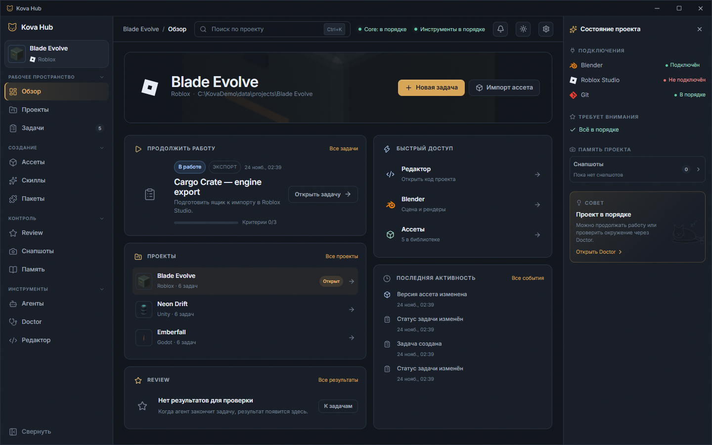
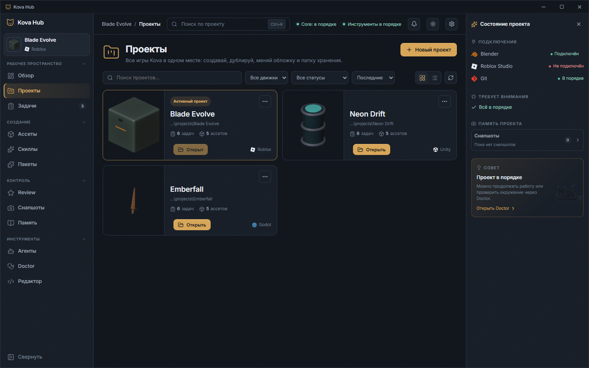
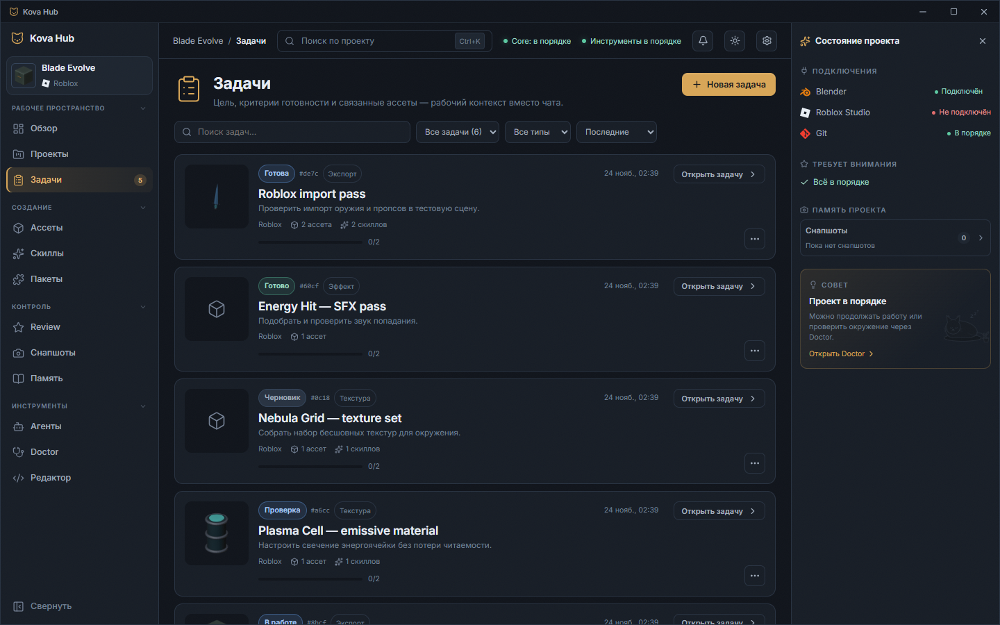
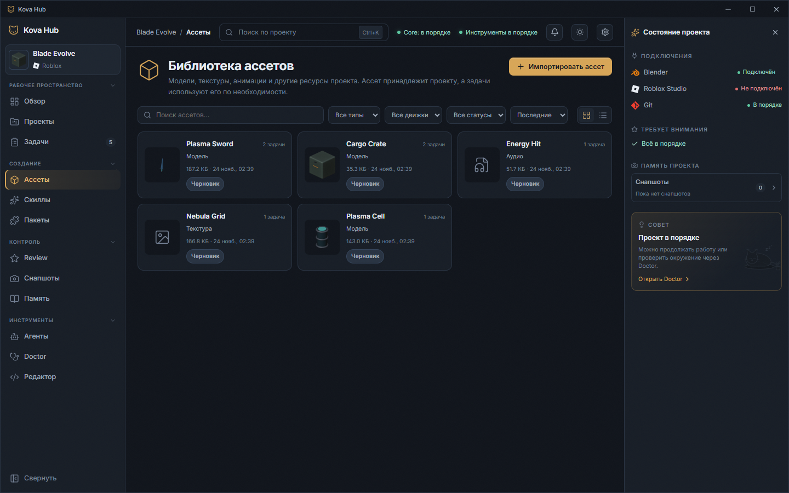
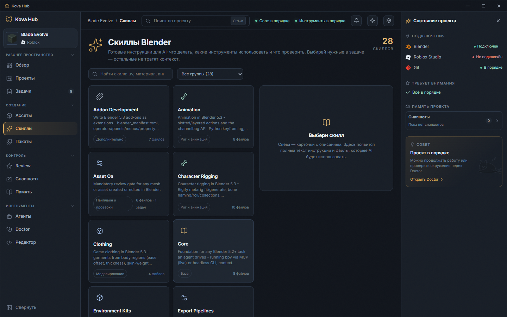
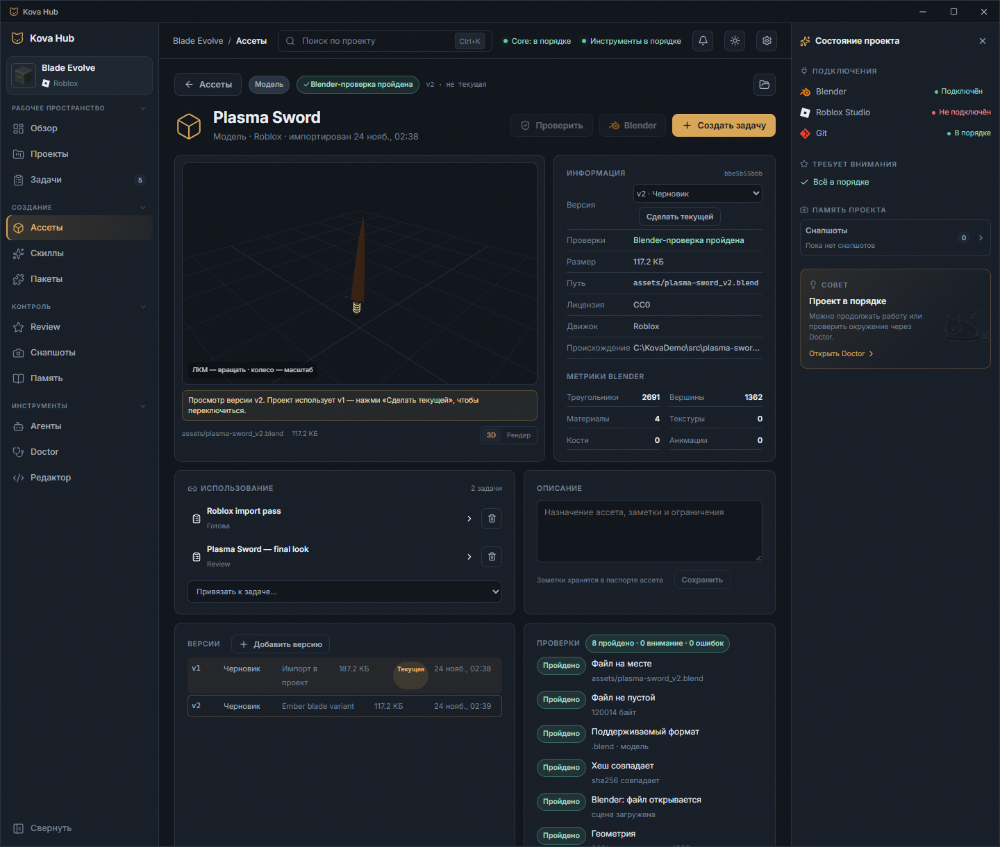
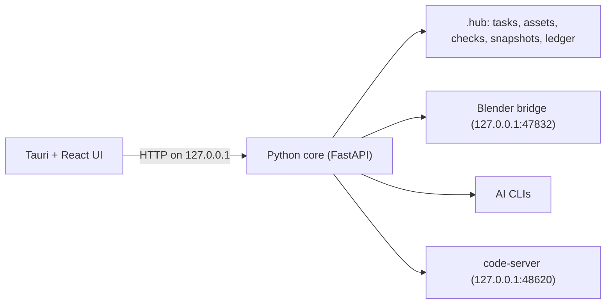

# Kova Hub

**A local-first desktop workspace for AI-assisted game development.**

Kova Hub connects the messy parts of a game project — briefs, assets, checks, Blender, AI agents, and an editor — around one project folder and one local ledger. It is built for people who want AI help without giving up ownership of the files, context, or pipeline.



<p>
  
  
  
</p>

> Kova Hub is an early preview. The data model and UI can still change. Windows is the supported platform today.

## Why Kova Hub

Most AI game-dev workflows lose context between chats, files, and engine editors. Kova keeps that context in the project itself:

- **Projects** are real folders with covers, engines, and local metadata.
- **Tasks** are briefs with goals, criteria, constraints, skills, and linked assets.
- **Assets** are passports: versions, hashes, previews, Blender metrics, checks, and usage.
- **Checks** are stored per asset version, so switching versions never shows stale results.
- **Snapshots and review** capture what changed and what needs another pass.
- **Everything is local** by default. The core listens on `127.0.0.1` and data stays in the project or `%APPDATA%\KovaHub`.

## Highlights

- Project dashboard with continue-work, quick access, activity, and review.
- Task board with rich cards, filters, archive, trash, restore, and permanent purge.
- Asset library with real previews, 3D viewer, versions, per-version checks, and usage links.
- Blender bridge: auto-installed add-on, live status, QA checks, model metrics, renders, and viewport screenshots.
- Skills library: 28 bundled Blender skills plus code, Roblox, Unity, Godot, Unreal, and general skills. Create, edit, delete, and lock skills from AI changes.
- CLI AI providers: Codex CLI, Claude Code, Gemini CLI, OpenCode, or your own command.
- OpenAI-compatible API providers with keys encrypted by Windows DPAPI.
- Execution sessions with live output, cancellation, handoff preview, and recovery after a core restart.
- Run queue per project, optional git worktree isolation, and a read-only mode with user-defined flags.
- Task validation commands, a review gate for failed or stale checks, and file diffs with unified patches.
- Linear workflow steps that stop after each step, plus a token budget based only on real usage.
- Built-in editor based on [code-server](https://github.com/coder/code-server), plus “open in VS Code” support.
- Local ledger, snapshots, Doctor, and a dark/light UI.

## Screenshots

The current interface ships in Russian. Screenshots use demo project data.

| Projects | Tasks |
| --- | --- |
|  |  |
| **Assets** | **Skills** |
|  |  |

### Asset passport with versions and a live 3D viewer



Each version has its own file, hash, size, preview, Blender metrics, and checks. The 3D viewer opens `.glb`/`.gltf` directly and converts `.blend`/`.fbx`/`.obj` through Blender when available.

## How it works



A project folder looks like this:

```text
MyGame/
  assets/                 # imported asset files
  .hub/
    project.json
    tasks/{active,done,archive,trash}/
    assets/               # asset passports
    checks/assets/        # version-scoped check results
    agents/               # sessions, runs, handoffs, diffs
    checks/tasks/         # task validation results
    artifacts/            # previews and renders
    snapshots/
    ledger/
    cover.*
```

The desktop shell is Tauri + React. The core is a separate Python process that owns project state. Blender, AI CLIs, and the editor are optional integrations.

## Requirements

### To run a source checkout

- Windows 10 or 11 (x64)
- [WebView2 Runtime](https://developer.microsoft.com/microsoft-edge/webview2/) (preinstalled on Windows 11)
- Python 3.11+
- Node.js 20+ (build time)
- Rust 1.77.2+ with the MSVC toolchain (build time only)
- Git

Optional:

- Blender 4.2+ (tested with 5.2 LTS) for QA, renders, and `.blend`/`.fbx`/`.obj` 3D previews.
- One or more AI CLIs for agent runs.
- Internet access for the built-in editor and extensions.

## Install

### One command

Windows 10/11, PowerShell:

```powershell
powershell -NoProfile -ExecutionPolicy Bypass -Command "irm https://raw.githubusercontent.com/AlexeyKurgan/Kova/main/install.ps1 | iex"
```

The script downloads the latest GitHub release, verifies SHA256 against
`manifest.json`, installs silently and launches Kova Hub. No Python, Node or
developer tools are needed.

Manual installers: [GitHub Releases](https://github.com/AlexeyKurgan/Kova/releases/latest).

### Build from source

Install the toolchain with `winget`:

```powershell
winget install --id Git.Git -e
winget install --id OpenJS.NodeJS.LTS -e
winget install --id Python.Python.3.12 -e
winget install --id Microsoft.VisualStudio.2022.BuildTools -e --override "--wait --quiet --add Microsoft.VisualStudio.Workload.VCTools --includeRecommended"
winget install --id Rustlang.Rustup -e
winget install --id Microsoft.EdgeWebView2Runtime -e
rustup default stable-msvc
```

Restart the terminal, then:

```powershell
git clone <repository-url> KovaHub
cd KovaHub
powershell -ExecutionPolicy Bypass -File scripts\setup.ps1
```

Development:

```powershell
powershell -ExecutionPolicy Bypass -File scripts\dev.ps1
```

Production build:

```powershell
powershell -ExecutionPolicy Bypass -File scriptsuild.ps1
powershell -ExecutionPolicy Bypass -File scripts
un-app.ps1
```

### Packaging status

The MSI/NSIS installers are now **self-contained**: `scriptsuild.ps1` builds the Python core with PyInstaller (`scriptsuild-core.ps1`), and Tauri bundles it as a sidecar. The installed app starts the core on `127.0.0.1:8765` automatically and stops it on exit.

- An existing core on port `8765` is reused, so source-checkout development still works.
- A clean install no longer needs Python, a virtualenv, or a separate core process.
- Set `KOVA_SKIP_CORE_BUILD=1` to rebuild only the shell when the sidecar is already current.
- Building from source still needs Python 3.11+, `pip install -e ./core`, and `pyinstaller`.

## Core commands

```powershell
npm run core:install     # pip install -e ./core
npm run core:dev         # start the core on 127.0.0.1:8765
npm run dev              # Vite dev server only
npm run build            # typecheck + frontend build
npm run typecheck        # tsc --noEmit
npm run tauri            # Tauri CLI
```

Useful scripts:

| Script | Purpose |
| --- | --- |
| `scripts\setup.ps1` | Check prerequisites, install npm/Python dependencies |
| `scripts\dev.ps1` | Start the core and `tauri dev` |
| `scripts\build.ps1` | Build the desktop app and installers |
| `scripts\run-core.ps1` | Start only the Python core |
| `scripts\run-app.ps1` | Start the core and the built app |

## First project

1. Launch Kova Hub and create a project (or open an existing folder).
2. Add a task with a goal, criteria, constraints, and optional skills.
3. Import assets — files are copied into `<project>/assets`.
4. Link assets to tasks. One asset can serve many tasks; a task can use many assets.
5. Run basic checks, then a Blender check for real metrics and a preview.
6. Use the AI panel to send a task capsule to a configured CLI and review the result.
7. Save snapshots before risky changes; use Review and the ledger to see what happened.

## Blender integration

- Install Blender 4.2 or newer and open it once.
- Kova installs and updates its `kova_bridge` add-on automatically.
- The bridge listens locally on port `47832`; the Blender sidebar has a **Kova** panel.
- Set `KOVA_BLENDER` to a custom `blender.exe` path if auto-detection fails.
- Models can be inspected, QA-checked, rendered, and screenshotted from Kova.
- `.blend`, `.fbx`, and `.obj` previews are converted to a temporary GLB through Blender and cached in `.hub/artifacts/viewer`.
- The add-on is licensed **GPL-3.0-or-later** because it runs inside Blender. Blender itself is not bundled.

## AI providers

Open **Agents** in the sidebar, add a provider, and point it at a CLI command. Presets exist for:

- `codex` — OpenAI Codex CLI
- `claude` — Claude Code
- `gemini` — Gemini CLI
- `opencode` — OpenCode CLI

Install and authenticate each CLI yourself. Provider configuration is stored in `%APPDATA%\KovaHub\providers.json`. Kova never stores CLI logins.

The Agents page has three add modes: **CLI**, **API provider**, and **local connector** (Ollama / LM Studio on localhost, no key). **From catalog** connects OpenAI, Anthropic, Google AI Studio, OpenRouter, DeepSeek, xAI, and Z.AI with a key; models are discovered automatically after saving.

Cloud adapters are separate because auth differs:

- **Azure OpenAI** — resource URL with deployment, `api-key`, manual deployment name.
- **Google Vertex AI** — project + region, access token from `GOOGLE_ACCESS_TOKEN` or `gcloud auth print-access-token`.
- **AWS Bedrock** — region + model ID, SigV4 from `AWS_ACCESS_KEY_ID` / `AWS_SECRET_ACCESS_KEY`. The adapter supports Anthropic Claude models; other model families need their own request format.

Models for these clouds are entered manually; Kova does not invent a model list.

API keys are encrypted with Windows DPAPI in `%APPDATA%\KovaHub\secrets.json` and are never returned by the local API.

Native providers can use tools in a bounded loop: list files, read, write, delete, and optionally run commands. The scope is chosen before the run:

- **Read only** — only `list_dir` and `read_file`.
- **Workspace** (default) — plus `write_file` and `delete_file` inside the project.
- **Auto** — plus `run_command` in the project folder.

The policy limits which tools are available, and every `write_file`, `delete_file`, or `run_command` pauses the run for explicit approval. You can allow once, allow all for that run, or deny; deny cancels the run. Tool calls are shown in the run details, and file changes go through the normal snapshot/diff/Review flow.

Request formats are explicit, not guessed: **OpenAI-compatible**, **Anthropic Messages**, and **Google Gemini**. The selected format controls the request body, auth headers, and streaming parser.

The **Models** tab can load models from the CLI or API (`opencode models`, or `GET /models`) and search them. Pick a default model there; it is used when the provider args contain `{model}`. Manual models are supported for CLIs without a list command.

### Agent runs and sessions

A task owns one or more **execution sessions**. Each session groups runs, handoff packages, snapshots, and status. Runs stream stdout/stderr into the task panel, can be cancelled, and are marked `interrupted` if the core stops mid-run.

- **Continue** uses the real CLI session when the provider exposes a session id and resume flags (Codex, Claude, OpenCode presets). The CLI keeps its own context; Kova sends only the new message.
- **Hand over** creates a new session with a handoff package when continuing with another provider or when resume is unavailable.
- **Handoff preview** shows exactly what the next agent will receive before you start.
- **Queue** limits parallel runs per project (1–4). With one slot, runs wait instead of writing over each other.
- **Worktree isolation** (git projects) runs an agent in a separate copy of `HEAD`. Changes are shown in Review and applied to the project only by explicit click, with a snapshot first.
- **Read-only mode** uses flags you configure per provider. Kova does not guess flags or intercept commands.

### Checks and review

Validation commands are task-level and user-editable. Kova can suggest commands from `package.json`, `tsconfig.json`, `pyproject.toml`, `pytest`, `Cargo.toml`, `go.mod`, `Makefile`, or .NET project files. Checks run only when you click, with your OS permissions.

Review compares the run against its pre-run snapshot, shows added/modified/deleted files, line counts, unified patches, and check results. Failed, missing, or stale checks require an explicit confirmation before accepting.

### Workflow and budget

Tasks can hold ordered workflow steps. **Run step** sends that step's prompt to the selected agent, and the workflow stops there: the next step starts only when you approve it. A failed run marks the step failed; a cancelled run returns it to pending.

Set a project **token limit** in Agents. Kova sums only real token counts reported by CLIs or APIs. If a provider returns no usage, the run is counted as unknown and the UI says so instead of inventing numbers. `0` disables the limit.

**Routing rules** map task tags to a recommended provider. The recommendation is shown in the task; Kova does not silently switch providers. **Roles** add a name and instructions to the prompt and can be attached to a task. Both live in `%APPDATA%\KovaHub\routing.json`.

### Honest limits

- Kova does not intercept commands the CLI runs inside itself.
- File write boundaries come from the CLI sandbox/flags, not from Kova.
- Tokens and cost come from real CLI output when the provider emits usage (for example Codex JSONL or Claude JSON); otherwise they show `Unknown`. There are no invented budgets.
- There is no automatic provider fallback or automatic merge.

## Built-in editor and VS Code

- The **Editor** screen downloads [code-server](https://github.com/coder/code-server) 4.146.0 on demand to `%LOCALAPPDATA%\KovaHub\editor`.
- It runs locally on `127.0.0.1:48620` with authentication disabled, so do not expose the port.
- Extensions are installed on request from the code-server extension registry.
- “Open in VS Code” launches a locally installed VS Code if one is available.
- Kova does not bundle Microsoft VS Code binaries or the Microsoft Marketplace. See [THIRD_PARTY_NOTICES.md](THIRD_PARTY_NOTICES.md).

## Where data lives

| Path | Contents |
| --- | --- |
| `<project>/` | Source project and `assets/` |
| `<project>/.hub/` | Project metadata, tasks, passports, checks, snapshots, ledger, previews |
| `%APPDATA%\KovaHub\projects.json` | Project registry |
| `%APPDATA%\KovaHub\providers.json` | AI provider configuration |
| `%APPDATA%\KovaHub\capabilities.json` | Probed CLI capabilities |
| `%APPDATA%\KovaHub\secrets.json` | API keys encrypted with Windows DPAPI |
| `%APPDATA%\KovaHub\worktrees\` | Temporary git worktrees for isolated runs |
| `%APPDATA%\KovaHub\projects\` | Projects created through Kova |
| `%LOCALAPPDATA%\KovaHub\editor\` | code-server and extensions |
| `%LOCALAPPDATA%\KovaHub\blender\bridge.json` | Blender bridge discovery |

Local project data and `.hub` folders are gitignored by default. Back up `.hub` and `assets` together if you move a project.

## Repository layout

```text
apps/desktop/            Tauri shell + React UI
core/kova_core/          FastAPI core, domain, storage, checks, integrations
core/kova_core/integrations/blender/
                        Blender bridge, skills, add-on
core/tests/              Python tests
packages/                Reserved for engine-specific packages
scripts/                 Setup, dev, build, and diagnostic scripts
media/screenshots/       README screenshots
docs/                    Internal notes (gitignored)
```

## Troubleshooting

**The UI shows “Core: недоступен”.**
Start the core with `scripts\run-core.ps1` and check that port `8765` is free:
`Get-NetTCPConnection -LocalPort 8765`.

**The app opens blank.**
Install or repair the WebView2 Runtime.

**Rust build fails with missing linker or `link.exe`.**
Install the Visual Studio Build Tools C++ workload and run `rustup default stable-msvc`.

**Blender is installed but Kova does not see it.**
Open Blender once, then check the Blender panel in Kova. Set `KOVA_BLENDER` to the full `blender.exe` path if needed.

**3D preview does not load for a `.blend`, `.fbx`, or `.obj`.**
Those formats need Blender for conversion. `.glb` and `.gltf` work without it. Check the Blender installation and the generated cache in `<project>/.hub/artifacts/viewer`.

**The editor fails to download.**
Check internet access and antivirus rules for `%LOCALAPPDATA%\KovaHub\editor`. The download comes from the official code-server GitHub releases.

## Tests

```powershell
cd core
python -m pytest -q
cd ..
npm run typecheck
```

The bundled UI/diagnostic scripts under `scripts/` are development helpers and may expect a local demo project.

## License and third-party rights

Kova Hub is released under the [MIT License](LICENSE).

Short version of the legal picture:

- The Kova codebase can be used, modified, and redistributed under MIT.
- Bundled libraries keep their own licenses (React, Three.js, Tauri, FastAPI, and others are permissive; Inter is OFL; Lucide is ISC). Their notices are summarized in [THIRD_PARTY_NOTICES.md](THIRD_PARTY_NOTICES.md). Include full license texts when you ship binaries.
- The Blender add-on is GPL-3.0-or-later. Blender itself is GPL and is **not** bundled.
- The editor is code-server (MIT), downloaded at runtime and **not** redistributed. Kova does not ship Microsoft VS Code builds or the Microsoft Marketplace.
- Brand names and logos (Roblox, Unity, Godot, Unreal, Blender, OpenAI, Anthropic, Gemini, OpenCode, GitHub, Microsoft, VS Code) belong to their owners. They are used only to identify the tools Kova works with. Kova is not affiliated with or endorsed by them.
- Engines, AI services, extensions, and assets you use with Kova are governed by their own licenses and terms.

This summary is not legal advice. If you plan a commercial release, review the final dependency list with a license scanner.

## Contributing

Issues and pull requests are welcome. Before opening a PR:

```powershell
cd core
python -m pytest -q
cd ..
npm run typecheck
```

Please keep changes local-first, avoid invented asset metrics, and keep checks tied to the asset version they were run against.
